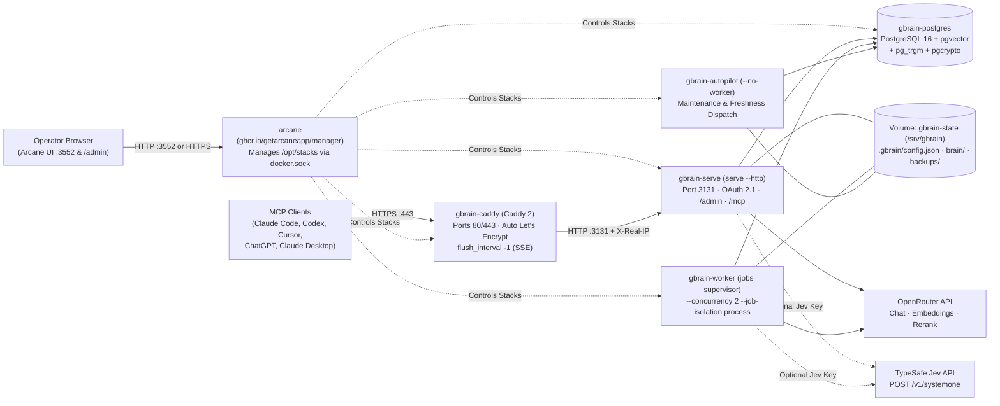

# GBrain Production Cookbook: Self-Hosting on Contabo VM with Arcane Docker Manager, Caddy, OpenRouter & System One (Jev)

This cookbook is the complete, end-to-end production guide for deploying **GBrain** from scratch on a **Contabo Linux VM** managed by **[Arcane](https://github.com/getarcaneapp/arcane)** (`ghcr.io/getarcaneapp/manager:latest`), with **Caddy** for automatic Let's Encrypt HTTPS, **PostgreSQL 16 + pgvector**, **OpenRouter** for LLM/embeddings/reranking, and **System One (Jev)** for typed decisions.

---

## 1. Architecture & Why Arcane

### 1.1 Why Arcane Instead of Coolify?
* **Ultra-Low Footprint (~35 MB RAM)**: Arcane is a single lightweight Go binary (`ghcr.io/getarcaneapp/manager:latest`) compared to Coolify's 5-container PHP/Laravel/Redis/Postgres/Soketi control plane (~1.5 GB RAM). Every megabyte saved goes directly to PostgreSQL HNSW vector indexes (`shared_buffers`, `maintenance_work_mem`) and GBrain workers.
* **Native Compose & `.env` Management**: Arcane reads and writes standard `compose.yaml` and `.env` files on disk inside `/opt/stacks`—you are never locked out of running standard `docker compose` commands via SSH.
* **Built-in Git Sync (Pull & Push)**: Arcane can pull stack updates directly from your Git repository (`gbrain-deploy.git`) and trigger deployments automatically.
* **Rich Day-2 UI**: Live container logs, CPU/RAM metrics, one-click web terminal into `gbrain-serve`, image update notifications, and volume/network browsers.

### 1.2 Production Topology on Contabo VM



### 1.3 Critical Arcane Invariant: Identical Host & Container Stack Path (`/opt/stacks:/opt/stacks`)
Because Arcane runs inside a container and talks to the host's Docker daemon via `/var/run/docker.sock` (Docker-out-of-Docker), any relative path in a project's `compose.yaml`—such as:
* `build: context: .`
* `./Caddyfile:/etc/caddy/Caddyfile:ro`
* `./initdb:/docker-entrypoint-initdb.d:ro`

is resolved by the **host Docker daemon** using the path Arcane passes to it.
In our `arcane-compose.yml`, we set:
```yaml
volumes:
  - /opt/stacks:/opt/stacks
environment:
  PROJECTS_DIRECTORY: /opt/stacks
```
Because `/opt/stacks/gbrain` is the **exact same path** inside the Arcane container and on the Contabo host, building `Dockerfile`, mounting `./Caddyfile`, and mounting `./initdb` work seamlessly whether triggered from the Arcane Web UI, Arcane Git Sync, or the host terminal.

---

## 2. Directory & File Layout

| File | Target Location on VM | Purpose |
|---|---|---|
| [`arcane-compose.yml`](./arcane-compose.yml) | `/opt/arcane/compose.yaml` | Launches the **Arcane Manager** (`ghcr.io/getarcaneapp/manager:latest`) on port `3552`. |
| [`compose.yaml`](./compose.yaml) | `/opt/stacks/gbrain/compose.yaml` | Launches the 5-service **GBrain Production Stack** (`gbrain-caddy`, `gbrain-postgres`, `gbrain-serve`, `gbrain-worker`, `gbrain-autopilot`). |
| [`Caddyfile`](./Caddyfile) | `/opt/stacks/gbrain/Caddyfile` | Automatic Let's Encrypt HTTPS for `${GBRAIN_DOMAIN}` with unbuffered SSE (`flush_interval -1`), plus optional HTTPS proxy for Arcane. |
| [`Dockerfile`](./Dockerfile) | `/opt/stacks/gbrain/Dockerfile` | Packages the official pre-compiled `gbrain-linux-x64` binary (~10–15s build time, zero npm/Vite compilation). |
| [`.env.production.example`](./.env.production.example) | `/opt/stacks/gbrain/.env` | Production environment variables (Domain, Admin Bootstrap Token, Postgres password, OpenRouter & System One keys). |
| [`initdb/01-extensions.sql`](./initdb/01-extensions.sql) | `/opt/stacks/gbrain/initdb/01-extensions.sql` | Enables `vector`, `pg_trgm`, `pgcrypto`, and `pg_prewarm` on first Postgres boot. |
| [`scripts/setup-vm-arcane.sh`](./scripts/setup-vm-arcane.sh) | Run once on host | Turnkey Contabo VM bootstrap script (NTP, Docker, Arcane Manager, GBrain `.env` generation, nightly cron). |
| [`scripts/entrypoint.sh`](./scripts/entrypoint.sh) | `/usr/local/bin/gbrain-entrypoint` | Coordinates `serve` (init + migrations + OpenRouter config), `worker`, and `autopilot` startup order. |
| [`scripts/configure-openrouter-jev.sh`](./scripts/configure-openrouter-jev.sh) | `/usr/local/bin/gbrain-configure-openrouter` | Configures OpenRouter model tiers, Cohere reranker, `gbrain pricing set` rates, and System One Jev slots. |
| [`scripts/gbrain-run.sh`](./scripts/gbrain-run.sh) | `/usr/local/bin/gbrain-run` | Canonical unattended CLI wrapper (`GBRAIN_HOME=/srv/gbrain`). |
| [`scripts/backup.sh`](./scripts/backup.sh) & [`scripts/restore.sh`](./scripts/restore.sh) | `/usr/local/bin/gbrain-backup` & `gbrain-restore` | Full 3-plane backup & restore (`pg_dump` + `.gbrain` config + Git bundle). |

---

## 3. Step-by-Step Installation from Scratch on a Contabo VM

### Step 1: Point Your DNS Record to Contabo
In your DNS provider (Cloudflare, Namecheap, Route53, etc.):
1. Create an **`A` record** for your GBrain domain (e.g., `gbrain.touchesai.com`) pointing to your Contabo VM's public IPv4 address.
2. *(Optional)* If you also want HTTPS for the Arcane dashboard (e.g., `arcane.touchesai.com`), create a second **`A` record** pointing to the same IPv4 address.
3. *Note for Cloudflare users*: Set Proxy status to **DNS Only (Gray Cloud)** during initial setup so Caddy can complete the Let's Encrypt ACME HTTP-01/TLS-ALPN-01 challenge cleanly.

---

### Step 2: SSH Into Your Contabo VM & Configure the Firewall
SSH into your fresh Ubuntu 22.04 / 24.04 or Debian 12 Contabo VM as `root`:

```bash
ssh root@<YOUR_CONTABO_VM_IP>
```

Install base utilities and configure the `ufw` firewall:

```bash
apt-get update && apt-get upgrade -y
apt-get install -y git curl jq openssl ufw

# Always allow SSH, HTTP (80), and HTTPS (443)
ufw allow 22/tcp
ufw allow 80/tcp
ufw allow 443/tcp

# Allow Arcane Web UI port 3552 (or restrict to your IP / use SSH tunnel; see Step 6 for HTTPS via Caddy)
ufw allow 3552/tcp

ufw --force enable
ufw status
```

---

### Step 3: Clone Deployment Files & Run the Arcane Bootstrap Script
Clone your deployment repository onto the VM and run `scripts/setup-vm-arcane.sh`:

```bash
git clone https://github.com/JamesNguyenWeb3/gbrain-deploy.git /opt/gbrain-deploy
cd /opt/gbrain-deploy
sudo bash scripts/setup-vm-arcane.sh
```

*(Or if copying from your local machine directly via `scp`):*
```bash
# On your local Mac:
scp -r ./deploy/arcane root@<YOUR_CONTABO_VM_IP>:/opt/gbrain-deploy

# On your Contabo VM:
cd /opt/gbrain-deploy && sudo bash scripts/setup-vm-arcane.sh
```

**What `setup-vm-arcane.sh` does automatically:**
1. **Sets Vietnam Timezone (`Asia/Ho_Chi_Minh`, UTC+7) & Fixes Clock Drift**: Runs `timedatectl set-timezone Asia/Ho_Chi_Minh` and enables NTP (`timedatectl set-ntp true`) so cron schedules, TLS certificates, OAuth 2.1 tokens, and Arcane JWTs all run on Vietnam local time without clock skew.
2. **Installs Docker**: Installs Docker Engine + Docker Compose plugin and enables `docker.service` on boot.
3. **Starts Arcane Manager (`/opt/arcane`)**: Generates cryptographic 32-byte `ENCRYPTION_KEY` and `JWT_SECRET` in `/opt/arcane/.env` and starts `ghcr.io/getarcaneapp/manager:latest` on port `3552`.
4. **Stages GBrain in `/opt/stacks/gbrain`**: Copies the GBrain stack into `/opt/stacks/gbrain` (where Arcane's `PROJECTS_DIRECTORY=/opt/stacks` automatically discovers it) and generates `/opt/stacks/gbrain/.env` with a fresh 48-character `GBRAIN_ADMIN_BOOTSTRAP_TOKEN` and 32-character `POSTGRES_PASSWORD`.
5. **Installs Nightly Maintenance Cron (Vietnam Time, UTC+7)**: Creates `/etc/cron.d/gbrain-maintenance` (`TZ=Asia/Ho_Chi_Minh`) and restarts `cron` so jobs run off-peak in Vietnam: `02:00 AM` Dream cycle, `03:15 AM` 3-plane backup, and `Mon 05:00 AM` `doctor` + `embed --stale` sweep.

**Save the `GBRAIN_ADMIN_BOOTSTRAP_TOKEN` printed at the end of the script!**

---

### Step 4: Log In to the Arcane Web Dashboard
1. Open your browser to:
   ```text
   http://<YOUR_CONTABO_VM_IP>:3552
   ```
   *(Prefer not to expose port `3552` publicly? Run `ssh -L 3552:127.0.0.1:3552 root@<YOUR_CONTABO_VM_IP>` on your laptop and open `http://localhost:3552` instead).*
2. Sign in with Arcane's seeded first-boot credentials:
   * **Username**: `arcane`
   * **Password**: `arcane-admin`
3. Arcane will immediately prompt you to **set a new administrator password**. Choose a strong password and save it.

---

### Step 5: Configure `.env` & Deploy GBrain in Arcane

You have two ways to manage and deploy the GBrain stack inside Arcane:

#### Method A: Use the Pre-Staged Project in `/opt/stacks/gbrain` (Fastest)
Because `setup-vm-arcane.sh` already staged the project into `/opt/stacks/gbrain`, Arcane automatically indexes it!
1. In the Arcane sidebar, click **Projects** (or **Stacks**) → select **`gbrain`**.
2. Open the **Environment (`.env`)** tab in Arcane (or run `nano /opt/stacks/gbrain/.env` over SSH) and fill in your domain and OpenRouter key:
   ```dotenv
   GBRAIN_DOMAIN="gbrain.touchesai.com"
   ACME_EMAIL="admin@touchesai.com"
   GBRAIN_PUBLIC_URL="https://gbrain.touchesai.com"
   OPENROUTER_API_KEY="sk-or-v1-..."
   # Optional System One Jev key:
   TYPESAFE_API_KEY=""
   ```
   *(Keep the auto-generated `GBRAIN_ADMIN_BOOTSTRAP_TOKEN` and `POSTGRES_PASSWORD` values intact).*
3. Click **Save**, then click **Deploy / Up** in Arcane (or run on the VM):
   ```bash
   cd /opt/stacks/gbrain
   docker compose up -d --build
   ```

#### Method B: Use Arcane Git Sync (Continuous Deployment from GitHub)
If you want Arcane to pull changes directly from your Git repository (`https://github.com/JamesNguyenWeb3/gbrain-deploy.git`):
1. In Arcane, go to **Git Syncs** (or **Projects → From Git Repo**).
2. Configure the repository:
   * **Repository URL**: `https://github.com/JamesNguyenWeb3/gbrain-deploy.git`
   * **Branch**: `main`
   * **Compose File Path**: `docker-compose.arcane.yml` *(or `compose.yaml`)*
   * **Project Name**: `gbrain`
3. Paste the contents of `/opt/stacks/gbrain/.env` into the Project's `.env` editor in Arcane, set your `OPENROUTER_API_KEY`, and click **Deploy**.

---

### Step 6: (Optional) Put Arcane UI Behind Caddy HTTPS (`arcane.touchesai.com`)
Once GBrain is running, `gbrain-caddy` includes `extra_hosts: ["host.docker.internal:host-gateway"]` so it can also terminate Let's Encrypt HTTPS for Arcane itself:

1. Point a DNS `A` record for `arcane.touchesai.com` to your Contabo VM IP.
2. Edit `/opt/stacks/gbrain/Caddyfile` (via Arcane's file editor or `nano /opt/stacks/gbrain/Caddyfile`) and uncomment the bottom block:
   ```caddyfile
   arcane.touchesai.com {
   	encode zstd gzip
   	reverse_proxy host.docker.internal:3552
   }
   ```
3. Reload Caddy without downtime:
   ```bash
   docker exec gbrain-caddy caddy reload --config /etc/caddy/Caddyfile
   ```
4. Update `ARCANE_APP_URL=https://arcane.touchesai.com` and `ARCANE_BIND_IP=127.0.0.1` in `/opt/arcane/.env`, then run:
   ```bash
   docker compose -f /opt/arcane/compose.yaml --env-file /opt/arcane/.env up -d
   ufw delete allow 3552/tcp
   ```
   Now port `3552` is closed to the public internet and Arcane is only reachable over HTTPS at `https://arcane.touchesai.com`!

---

### Step 7: Verify First Boot, Health & Providers

Run these checks from your VM terminal (or inside Arcane UI → **Containers** → **`gbrain-serve`** → **Terminal**):

```bash
# 1. Verify all 5 GBrain containers + Arcane are healthy
docker ps --format "table {{.Names}}\t{{.Status}}\t{{.Ports}}"

# 2. Check deep HTTP + PostgreSQL pool health over HTTPS
curl -fsS https://gbrain.touchesai.com/health?deep=1 | jq .

# 3. Verify OpenRouter & TypeSafe provider status
docker exec gbrain-serve gbrain-run providers list

# 4. Verify search mode and Cohere reranker readiness
docker exec gbrain-serve gbrain-run search modes

# 5. If TYPESAFE_API_KEY is configured, probe System One Jev (sends zero brain content)
docker exec gbrain-serve gbrain-run decide probe
docker exec gbrain-serve gbrain-run decide status

# 6. Check Minions worker supervisor and autopilot status
docker exec gbrain-worker gbrain-run jobs supervisor status --json | jq .
docker exec gbrain-autopilot gbrain-run autopilot --status
```

---

## 4. OpenRouter & System One (Jev) Reference

### 4.1 What OpenRouter Powers (`OPENROUTER_API_KEY`)
`scripts/configure-openrouter-jev.sh` automatically configures GBrain's file-plane and DB-plane models on boot:

| Touchpoint | Env Var in `.env` | Default OpenRouter Model | Notes & Code Constraints |
|---|---|---|---|
| **Embeddings** | `GBRAIN_EMBEDDING_MODEL`<br>`GBRAIN_EMBEDDING_DIMENSIONS` | `openrouter:openai/text-embedding-3-small`<br>`1536` | Also supports `openrouter:openai/text-embedding-3-large` (`3072`), `openrouter:baai/bge-m3` (`1024`), `openrouter:qwen/qwen3-embedding-8b` (`4096`). |
| **Chat / Reasoning** | `GBRAIN_CHAT_MODEL`<br>`GBRAIN_TIER_REASONING_MODEL` | `openrouter:anthropic/claude-sonnet-4.6` | Automatic prompt caching (`cache_control: { type: 'ephemeral' }`) injected for `anthropic/claude-*`. |
| **Fast / Utility** | `GBRAIN_TIER_UTILITY_MODEL` | `openrouter:anthropic/claude-haiku-4.5` | Powers high-volume fact extraction and dream triage. |
| **Deep / Repair** | `GBRAIN_TIER_DEEP_MODEL` | `openrouter:anthropic/claude-opus-4.7` | Powers Tier 3 fence repair and deep synthesis. |
| **Subagent Loop** | `GBRAIN_TIER_SUBAGENT_MODEL` | `openrouter:anthropic/claude-sonnet-4.6` | **CRITICAL**: Must use `anthropic/*` or `deepseek/*` families on OpenRouter (`src/core/ai/openrouter-families.ts`). |
| **Query Expansion** | `GBRAIN_EXPANSION_MODEL` | `openrouter:google/gemini-3-flash-preview` | Fast query variant generation. |
| **Reranker** | `GBRAIN_RERANKER_MODEL` | `openrouter:cohere/rerank-v3.5` | Proxies `/api/v1/rerank`. Allowed: `cohere/rerank-v3.5`, `cohere/rerank-4-fast`, `cohere/rerank-4-pro`, `nvidia/llama-nemotron-rerank-vl-1b-v2:free`. |

### 4.2 OpenRouter Pricing Registration (`gbrain pricing set`)
OpenRouter models are listed under `unpriced_models` in `src/core/ai/recipes/openrouter.ts`. Whenever an explicit USD budget cap is used (`--max-usd`, client daily budgets), GBrain fails closed with `no_pricing` unless rates are registered. `configure-openrouter-jev.sh` registers these rates automatically on boot. To inspect or update them:
```bash
docker exec gbrain-serve gbrain-run pricing list
```

### 4.3 System One / Jev (`TYPESAFE_API_KEY`)
* **With `TYPESAFE_API_KEY` set**: Automatically enables `typesafe:jev-1.13.0` (`$0.042 / 1M input tokens`, output free) on the pre-calibrated `triage` and `conflict` slots (`gbrain decide enable --recommended --yes`), with `decide.egress_fallback` set to `llm:openrouter:anthropic/claude-haiku-4.5`.
* **Without `TYPESAFE_API_KEY`**: Decide slots remain cleanly `off` and GBrain uses its standard OpenRouter LLM paths.

---

## 5. Admin Dashboard & Connecting MCP Clients

### 5.1 Opening the `/admin` Dashboard
Navigate to `https://gbrain.touchesai.com/admin` and paste your `GBRAIN_ADMIN_BOOTSTRAP_TOKEN` from `/opt/stacks/gbrain/.env`, or mint a single-use 5-minute owner login link:

```bash
docker exec gbrain-serve \
  gbrain-run mcp admin login-link \
  --url "https://gbrain.touchesai.com/mcp" \
  --json
```
*(Do **not** `curl` or preview the generated URL before opening it in your browser—it is a single-use nonce).*

### 5.2 Connecting Coding Harnesses (Claude Code, Codex, Cursor) via Machine Handoff
On the Contabo VM, mint a scoped `memory-writer` credential file:

```bash
docker exec gbrain-serve \
  gbrain-run mcp grant my-laptop-claude \
  --harness claude-code \
  --profile memory-writer \
  --source default \
  --url "https://gbrain.touchesai.com/mcp" \
  --credentials-out /srv/gbrain/.gbrain/my-laptop-claude.json \
  --json
```

Copy the credential file to your laptop (`chmod 600 ~/.gbrain/my-laptop-claude.json`), then run on your laptop:

```bash
# Copy from Contabo VM to laptop:
scp root@<YOUR_CONTABO_VM_IP>:/var/lib/docker/volumes/gbrain_gbrain-state/_data/.gbrain/my-laptop-claude.json ~/.gbrain/my-laptop-claude.json
chmod 600 ~/.gbrain/my-laptop-claude.json

# Wire MCP + brain-first instructions:
gbrain connect https://gbrain.touchesai.com/mcp \
  --harness claude-code \
  --credentials-file ~/.gbrain/my-laptop-claude.json \
  --install
```

### 5.3 Connecting Native OAuth 2.1 + PKCE Clients (ChatGPT, Claude.ai, Claude Desktop, Cursor)
1. Register the OAuth client in `/admin` → **Agents** (or via CLI):
   ```bash
   docker exec gbrain-serve \
     gbrain-run mcp admin register claude-desktop \
     --redirect-uri "https://claude.ai/api/mcp/auth_callback" \
     --token-endpoint-auth-method none \
     --profile memory-writer \
     --source default \
     --url "https://gbrain.touchesai.com/mcp" \
     --json
   ```
   *(Or set `GBRAIN_ENABLE_DCR="1"` in `.env` so clients self-register at `/register`; owner approval in `/admin` is still required).*
2. Add `https://gbrain.touchesai.com/mcp` in Claude / ChatGPT / Cursor and approve the request when redirected to `/admin`.

### 5.4 Simple Scoped Bearer Token (For Scripts / Custom Agents)
```bash
docker exec gbrain-serve \
  gbrain-run auth create my-script-token --scopes read,write
```

---

## 6. Day-2 Operations, Backups & Safe Upgrades in Arcane

### 6.1 Automated Cron Jobs (`/etc/cron.d/gbrain-maintenance` — Vietnam Time `Asia/Ho_Chi_Minh`, UTC+7)
Installed automatically by `setup-vm-arcane.sh` (with host timezone set to `Asia/Ho_Chi_Minh`):

| Schedule (Vietnam Time, UTC+7) | Equivalent UTC | Command | Purpose |
|---|---|---|---|
| **Nightly `02:00 AM ICT`** | `19:00 UTC` (prev day) | `docker exec gbrain-serve /usr/local/bin/gbrain-run dream` | Nightly Dream Cycle (lint, backlinks, extract, sync, embed stale, triage & synthesize). |
| **Nightly `03:15 AM ICT`** | `20:15 UTC` (prev day) | `docker exec gbrain-serve /usr/local/bin/gbrain-backup` | Full 3-plane backup (`postgres.dump`, `.gbrain` config, Git bundle) with 14-day retention. |
| **Weekly `Mon 05:00 AM ICT`** | `Sun 22:00 UTC` | `docker exec gbrain-serve /usr/local/bin/gbrain-run doctor --json && ... embed --stale` | Weekly health audit and stale vector drain (before 8:00 AM Vietnam business hours). |

### 6.2 Manual Backup & Disaster Recovery Restore
**Run a manual backup at any time:**
```bash
docker exec gbrain-serve /usr/local/bin/gbrain-backup
```
Archives are stored in `/srv/gbrain/backups/gbrain-backup-YYYYMMDDTHHMMSSZ.tar.gz` (host path: `/var/lib/docker/volumes/gbrain_gbrain-state/_data/backups/`). Copy backups off-host daily (e.g., via `rclone` or `scp`).

**Restore from a backup archive:**
```bash
# 1. Stop worker and autopilot so no jobs run during restore
cd /opt/stacks/gbrain
docker compose stop worker autopilot

# 2. Restore all 3 planes (Postgres + .gbrain config + Git checkout) and verify belief ledger
docker exec gbrain-serve \
  /usr/local/bin/gbrain-restore /srv/gbrain/backups/gbrain-backup-YYYYMMDDTHHMMSSZ.tar.gz --yes

# 3. Start worker and autopilot back up
docker compose up -d
```

### 6.3 Upgrading GBrain Safely
1. **Check for active jobs before upgrading**:
   ```bash
   docker exec gbrain-serve gbrain-run jobs list --status active --json
   ```
2. **Update `GBRAIN_VERSION` and Rebuild**:
   * In Arcane UI → **Projects** → **`gbrain`**, update `GBRAIN_VERSION` in `.env` (or keep `latest`) and redeploy/rebuild, **or** via SSH:
     ```bash
     cd /opt/stacks/gbrain
     docker compose build --no-cache gbrain
     docker compose up -d
     ```
   * `gbrain-serve` automatically runs `gbrain apply-migrations --yes --non-interactive --no-autopilot-install` on startup before `worker` and `autopilot` start.
3. **Verify Post-Upgrade Health**:
   ```bash
   docker exec gbrain-serve gbrain-run doctor --only runtime_build_skew --json
   docker exec gbrain-serve gbrain-run doctor --json | jq '.score, .status'
   ```

### 6.4 Switching Embedding Models Later (`gbrain migrate embeddings`)
Never change `GBRAIN_EMBEDDING_MODEL` or `GBRAIN_EMBEDDING_DIMENSIONS` in `.env` without migrating the database vector column first:
```bash
# 1. Preview cost and plan
docker exec gbrain-serve \
  gbrain-run migrate embeddings --to openrouter:openai/text-embedding-3-large --dry-run

# 2. Execute migration (builds new vector column & HNSW index concurrently)
docker exec gbrain-serve \
  gbrain-run migrate embeddings --to openrouter:openai/text-embedding-3-large --yes
```
Then update `GBRAIN_EMBEDDING_MODEL` and `GBRAIN_EMBEDDING_DIMENSIONS` in `/opt/stacks/gbrain/.env` to match.

